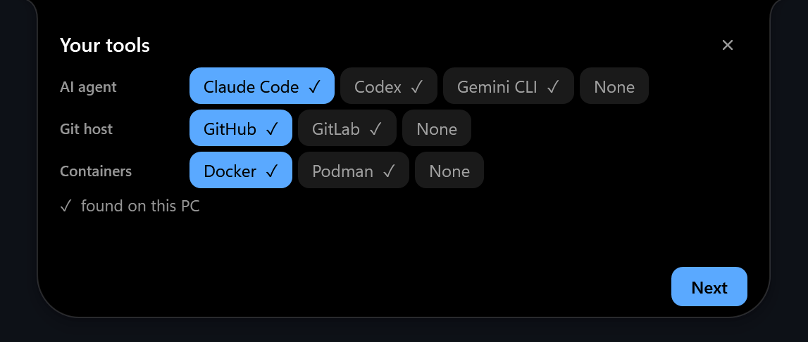
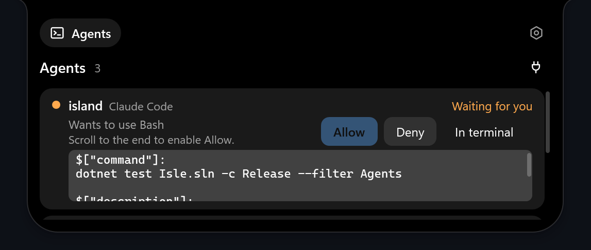
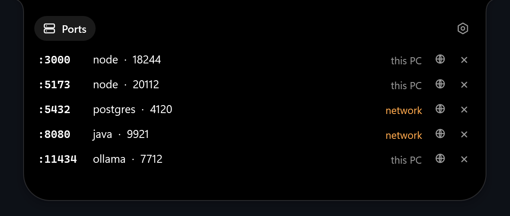
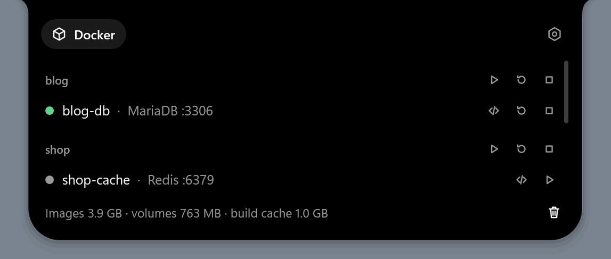
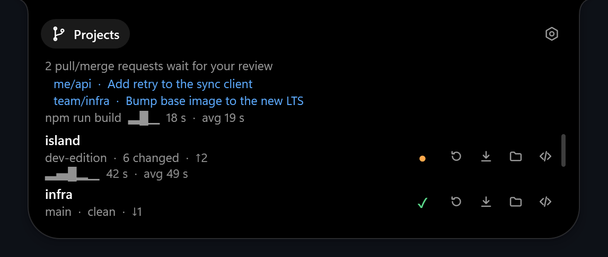
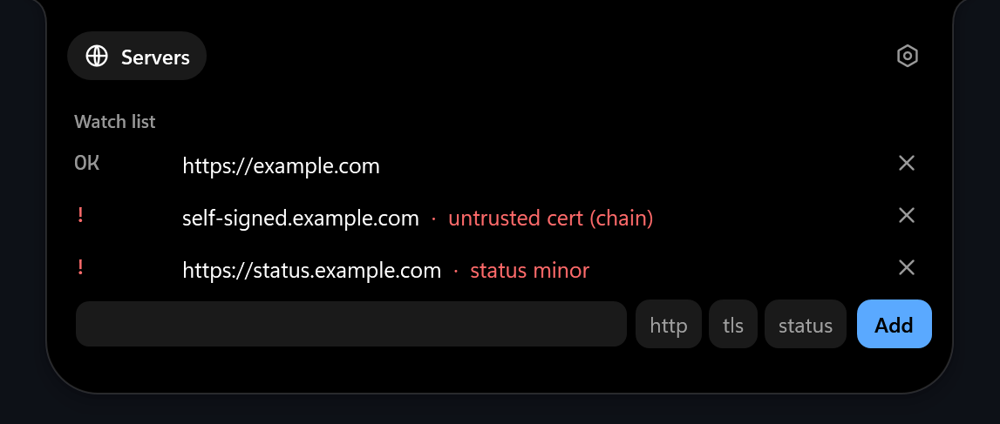
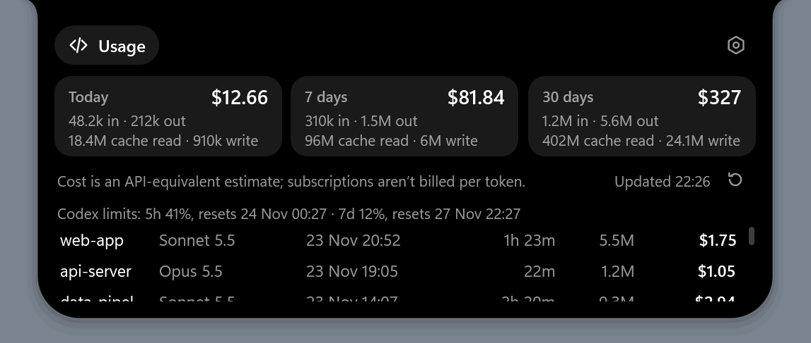

<div align="center">

# Masthead

**A Dynamic Island for Windows, for people who live in terminals.**<br>
A small notch that hangs from the top of the screen, shows what your machine and your coding agents are doing, and opens into a panel when you hover it.

[](#download)
[](https://dotnet.microsoft.com/)
[](LICENSE)
[](https://github.com/Va1Geny/masthead/actions/workflows/ci.yml)


[Download](#download) · [Features](#features) · [Build](#build-and-run) · [Contributing](CONTRIBUTING.md) · [Security](SECURITY.md) · [Changelog](CHANGELOG.md)

</div>

Masthead started as a Dev-focused fork of `BKyrychenko/island` (the original Isle, now called Skerry); all credit for
the island itself goes to its author. The upstream repository, which is not public, keeps the Community app (timers,
notes, clipboard, command bar, AI chat, weather and more). Masthead is one app with the shell, Music and the
developer features below, and nothing else.

## Screenshots

<table>
  <tr>
    <td align="center" width="50%"><br><b>First-run setup</b></td>
    <td align="center" width="50%"><br><b>Agents</b></td>
  </tr>
  <tr>
    <td align="center"><br><b>System</b></td>
    <td align="center"><br><b>Ports</b></td>
  </tr>
  <tr>
    <td align="center"><br><b>Docker</b></td>
    <td align="center"><br><b>Projects</b></td>
  </tr>
  <tr>
    <td align="center"><br><b>Servers</b></td>
    <td align="center"><br><b>Usage</b></td>
  </tr>
</table>

<sub>All screenshots use demo data.</sub>

## Features

- **First-run setup** — pick your coding agent (Claude Code, Codex, Gemini CLI), git host (GitHub, GitLab) and
  container engine (Docker, Podman), then the tabs and alerts you want. Tools found on the PC are marked; run it again
  any time from **Settings → Options**.
- **Music** — follows any app that reports to Windows media controls (Spotify, browsers, VLC…): a mini player in the
  pill with album art, title, artist and previous / play-pause / next, a banner on track change, and an accent colour
  taken from the art.
- **Agents** — cards for Claude Code and Codex sessions: permission requests you can answer from the island, subagent
  progress, the latest file edit, and a shortcut back to the session's terminal tab. Hooks for Claude Code, Codex and
  Gemini CLI; switching agents removes Masthead's hooks from the others.
- **System** — CPU (with the busiest core), memory, GPU load and VRAM, and network, each with a one-minute sparkline,
  plus the busiest processes with **End task**; a pill when CPU or memory stays above 90% for 30 seconds.
- **Ports** — what your dev servers and databases listen on, with **Open in browser** and **End**, plus your WSL
  distributions. A pill tells you when a new server starts.
- **Docker** — containers grouped by compose project over the Docker (or Podman) engine pipe, updated live from engine
  events: start / stop / restart, live-following logs, compose up / restart / down, friendly labels for local databases,
  disk usage and a cleanup that asks first (volumes are never pruned). Compose buttons appear only for projects whose
  compose files are on a local drive. Pills when a container keeps crashing or the engine stops.
- **Projects** — branch, changes and ahead/behind of watched repositories with the latest CI run (GitHub Actions via
  `gh`, GitLab pipelines), **Fetch** and fast-forward-only **Pull**, pull requests waiting for your review, GitLab merge
  requests, and a build-time sparkline per project. Pills when CI or a local build or test run (`dotnet`, `npm`,
  `cargo`, `go`, `pytest`, `make`…) finishes.
- **Servers** — hosts from `~/.ssh/config` (aliases with unusual characters are skipped) with an opt-in reachability
  check and **Open in Windows Terminal**; AWS profiles with the SSO login expiry, the Azure subscription and the gcloud account (all read-only); and a watch list of
  URLs and hosts checked for being down, an expiring or untrusted TLS certificate, or a status-page incident.
- **Usage** — Claude Code or Codex tokens for today, 7 and 30 days; an API-equivalent cost estimate for Claude and the
  current Codex rate-limit windows.
- **Log watcher** — the first new `ERROR` / `Exception` line of your log files in the pill.
- **Kubernetes** — a red pill while kubectl's current context looks like production.
- Settings in English and Ukrainian: theme, size, shape (notch or pill), monitor, apps to hide behind, the show/hide
  hotkey and per-module options.

## Keyboard

| Keys | Action |
|---|---|
| <kbd>Win</kbd>+<kbd>Alt</kbd>+<kbd>I</kbd> | Show / hide the island (global; rebind or disable in **Settings → Hotkeys**) |
| <kbd>Esc</kbd> or <kbd>Q</kbd> | Close the panel (<kbd>Esc</kbd> closes the More list first) |
| <kbd>J</kbd> / <kbd>K</kbd> | Next / previous row in the current tab |
| <kbd>H</kbd> / <kbd>L</kbd>, <kbd>←</kbd> / <kbd>→</kbd> on the tab bar | Previous / next tab |
| <kbd>1</kbd>–<kbd>9</kbd> or <kbd>Ctrl</kbd>+<kbd>1</kbd>–<kbd>9</kbd> | Jump to tab N |
| <kbd>Tab</kbd> on the selected tab | Move into that tab's content |

Panel keys work while the panel is open and focused; letters and digits are ignored while a text box has focus
(<kbd>Ctrl</kbd>+<kbd>1</kbd>–<kbd>9</kbd> still works).

No accounts, no telemetry. Everything lives in `%AppData%\Isle\` (override with `ISLE_DATA_DIR`). Config files of
other tools (`~/.ssh`, `~/.aws`, `~/.azure`, gcloud, `~/.kube`, glab) are only read, never written. The network is used
only by features you turn on:

| Feature | What talks to the network |
|---|---|
| Projects, GitHub | the `gh` and `git` CLIs, for repositories you add |
| Projects, GitLab | HTTPS to the GitLab host you configure (a plain host name, optionally with a port; token from Settings or your glab login), no redirects |
| Servers | TCP connects to the ssh hosts you switch on, and HTTP / TLS checks of the watch-list entries you add |

Docker and Podman are reached over their local named pipe only. Agent hooks are never installed silently:
**Settings → Options → Agents** shows exactly what will change and backs up the config file.

## Download

Grab the latest release (currently **1.1.0**) from the
[Releases](https://github.com/Va1Geny/masthead/releases) page:

- `Isle-v1.1.0-win-x64.zip` — small, needs the [.NET 10 Desktop Runtime](https://dotnet.microsoft.com/download/dotnet/10.0);
- `Isle-v1.1.0-win-x64-selfcontained.zip` — larger, runs without any runtime.

Unzip it to a permanent folder and run `Isle.exe` (the files keep their original name).

## Build and run

Requirements: Windows 10 (19041) or 11, x64, the [.NET 10 SDK](https://dotnet.microsoft.com/download).

```powershell
.\scripts\build.ps1                      # build, test, publish into dist\
.\dist\Isle\Isle.exe                     # framework-dependent (needs the .NET 10 Desktop Runtime)
.\dist\Isle-selfcontained\Isle.exe       # self-contained
```

Copy the folder somewhere permanent before enabling **Start with Windows**. For development `dotnet build` and
`dotnet test` work from the repository root. `Isle.exe --snapshot <state|all> <out.png|dir> [--theme Dark|Light]
[--lang en|uk] [--scale 1.5]` renders UI states to PNG.

```
src/Isle/          the app: Core, window, settings, tray, hotkeys, and Modules/ + Views/ for agents, media and the dev tools
src/Isle.Hook/     helper the coding agents call to talk to Masthead over a named pipe
tests/Isle.Tests/  xUnit tests
```

## Security

Masthead runs as you and treats everything it reads (repositories, CI and merge-request data, container labels and logs,
config files, server responses) as untrusted:

- The agent hook endpoint is a named pipe only your Windows account can open; connections from other machines are
  refused.
- Links from GitHub, GitLab, CI and the watch list open only if they are `https`.
- Command-line tools (`git`, `gh`, `docker`, `wt`…) are started with separate arguments, never through a shell, and are
  never picked up from the folder Masthead was started in.
- Agent hooks are refused for a helper path a shell could misread; the GitLab token goes only to the configured host.
- Tokens are encrypted with Windows DPAPI for your account and never logged; the AWS SSO cache is read for its expiry
  only.
- Streams and responses (Docker logs, status pages, GitLab) are size-capped.

The repository side: the build fails on NuGet packages with known high or critical vulnerabilities (transitive ones
included), workflow actions are pinned to commit SHAs, Dependabot raises security-fix pull requests, CodeQL scans the
C# code once the repository is public, and `main` is protected against force pushes and deletion. To report a
vulnerability, see [`SECURITY.md`](SECURITY.md).

## Needs re-verification

These parts are covered by unit tests and code review but have not yet been run against the real software, so treat
them as unverified until someone confirms them:

- **GitLab** — merge requests and pipelines (cloud and self-hosted) have only been tested against recorded API
  responses.
- **Podman** — the engine pipe (`\\.\pipe\podman-machine-default`) has not been tried with a real Podman machine.
- **Gemini CLI hooks** — installing, receiving events and removing them have not been tried with Gemini CLI installed.
- **Servers → Open in Windows Terminal** — the `wt.exe ssh <host>` launch (and its plain `ssh` fallback).

## Not supported (skipped on purpose)

- **GitHub Copilot CLI hooks** — the docs don't give the Windows command format or the stdin payload, so there was
  nothing reliable to build on.
- **Cursor CLI hooks** — hooks are unreliable on Windows.

## Releases and CI

Every push to `main` and every pull request is built, tested and smoke-checked on GitHub Actions
([`ci.yml`](.github/workflows/ci.yml)). Pushing a tag such as `v1.1.0` that matches `<Version>` in
`Directory.Build.props` publishes a GitHub release with both packages ([`release.yml`](.github/workflows/release.yml)).
Dependabot opens monthly update pull requests for the workflow actions and NuGet packages, plus security-fix pull
requests when an advisory appears. CodeQL ([`codeql.yml`](.github/workflows/codeql.yml)) runs on pushes, pull requests
and weekly; it skips itself while the repository is private.

More in [`docs/ARCHITECTURE.md`](docs/ARCHITECTURE.md) and [`docs/DECISIONS.md`](docs/DECISIONS.md). New user-facing text
goes into both the `en` and `uk` tables of `src/Isle/Core/Strings.Data.cs`; a test checks they match.

## Contributing

Bug reports, ideas and pull requests are welcome. Read [`CONTRIBUTING.md`](CONTRIBUTING.md) for the build, test and
snapshot workflow, and the [Code of Conduct](CODE_OF_CONDUCT.md). Notable changes are listed in
[`CHANGELOG.md`](CHANGELOG.md).

## License

[MIT](LICENSE)
