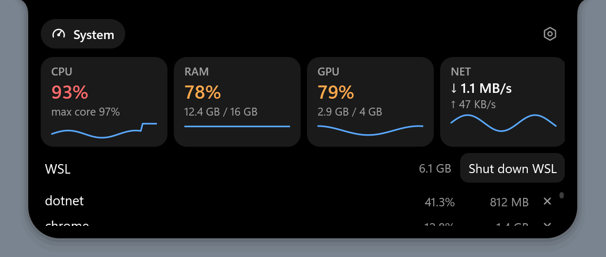

<div align="center">

# Isle (Dev fork)

**A Dynamic Island for Windows, for people who live in terminals.**<br>
A small notch that hangs from the top of the screen, shows what your machine and your coding agents are doing, and opens into a panel when you hover it.

[](#build-and-run)
[](https://dotnet.microsoft.com/)
[](LICENSE)

</div>

This is a Dev-focused fork of [BKyrychenko/island](https://github.com/BKyrychenko/island), the original Isle by its
author; all credit for the island itself goes there. The upstream repository keeps the Community app (timers, notes,
clipboard, command bar, AI chat, weather and more). This fork is one app, `Isle.exe`, with the shell, Music and the
developer features below, and nothing else.

## Features

- **Music** — follows any app that reports to Windows media controls (Spotify, browsers, VLC…): a mini player in the
  pill with album art, title, artist and play/pause, a banner on track change, and an accent colour taken from the art.
- **Agents** — cards for Claude Code and Codex sessions: permission requests you can answer from the island, subagent
  progress, the latest file edit, and a shortcut back to the session's terminal tab.
  
- **System** — CPU (with the busiest core), memory, GPU load and VRAM, and network, each with a one-minute sparkline,
  plus the busiest processes with **End task**; a pill when CPU or memory stays above 90% for 30 seconds.
  
- **Ports** — what your dev servers and databases listen on, with **Open in browser** and **End**; Docker containers
  and WSL distributions too. A pill tells you when a new server starts.
  
- **Projects** — branch, changes and ahead/behind of watched repositories with the latest GitHub Actions run, and pills
  when CI or a local build or test run (`dotnet`, `npm`, `cargo`, `go`, `pytest`, `make`…) finishes.
  
- **Log watcher** — the first new `ERROR` / `Exception` line of your log files in the pill.
- **Kubernetes** — a red pill while kubectl's current context looks like production.
- **Usage** — your Claude Code tokens for today, 7 and 30 days, with an API-equivalent cost estimate.
- Settings in English and Ukrainian: theme, size, shape (notch or pill), monitor, apps to hide behind, the show/hide
  hotkey (<kbd>Win</kbd>+<kbd>Alt</kbd>+<kbd>Space</kbd>) and per-module options.

No accounts, no telemetry. Everything lives in `%AppData%\Isle\` (override with `ISLE_DATA_DIR`). The network is used
only by Projects (the `gh` and `git` CLIs, for repositories you add). Agent hooks are never installed silently:
**Settings → Options → Agents** shows exactly what will change and backs up the config file.

## Build and run

Requirements: Windows 10 (19041) or 11, x64, the [.NET 10 SDK](https://dotnet.microsoft.com/download). Optional:
`rustc` 1.85+ with the MSVC target for the small `Isle.Launcher.exe`; without it the build script skips it.

```powershell
.\scripts\build.ps1                      # build, test, publish into dist\
.\dist\Isle\Isle.exe                     # framework-dependent (needs the .NET 10 Desktop Runtime)
.\dist\Isle-selfcontained\Isle.exe       # self-contained
```

Copy the folder somewhere permanent before enabling **Start with Windows**. For development `dotnet build` and
`dotnet test` work from the repository root. `Isle.exe --snapshot <state|all> <out.png|dir> [--theme Dark|Light]
[--lang en|uk] [--scale 1.5]` renders UI states to PNG.

```
src/Isle/          the app: Core, window, settings, tray, hotkeys, and Modules/ + Views/ for agents, media and the dev tools
src/Isle.Hook/     helper the coding agents call to talk to Isle over a named pipe
src/Isle.Launcher/ small Rust launcher that starts Isle.exe
tests/Isle.Tests/  xUnit tests
```

More in [`docs/ARCHITECTURE.md`](docs/ARCHITECTURE.md) and [`docs/DECISIONS.md`](docs/DECISIONS.md). New user-facing text
goes into both the `en` and `uk` tables of `src/Isle/Core/Strings.Data.cs`; a test checks they match.

## License

[MIT](LICENSE)
